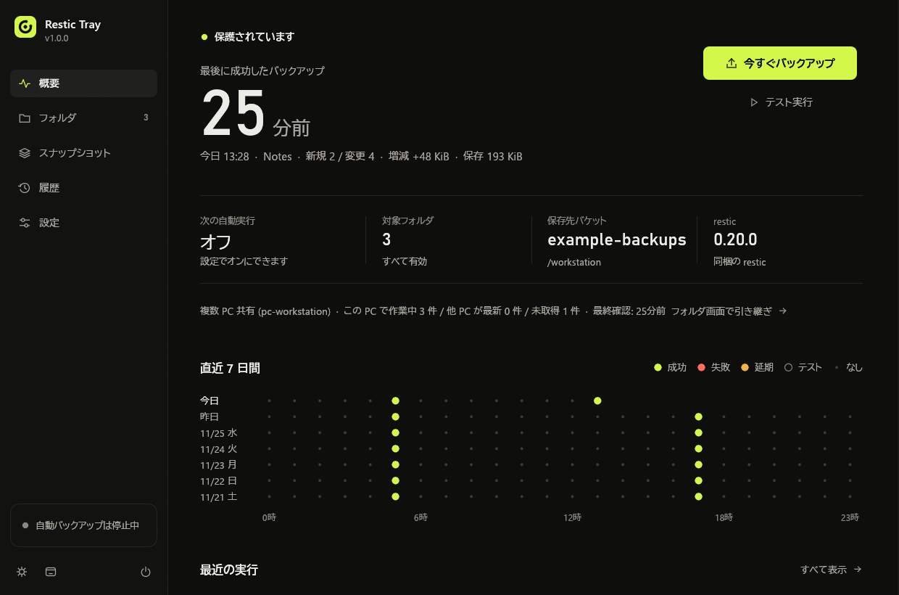
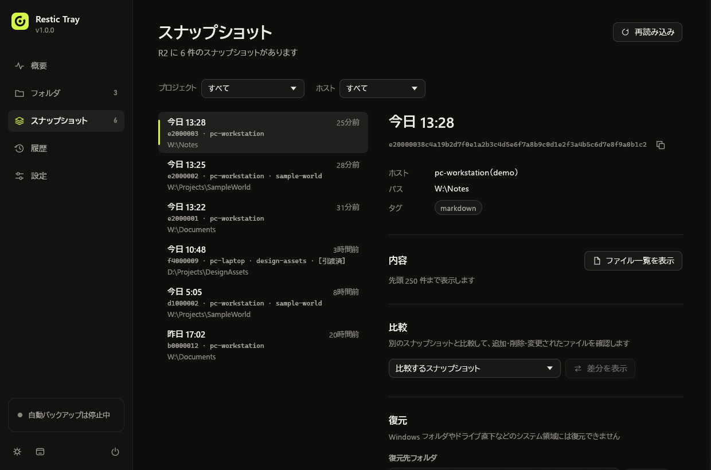
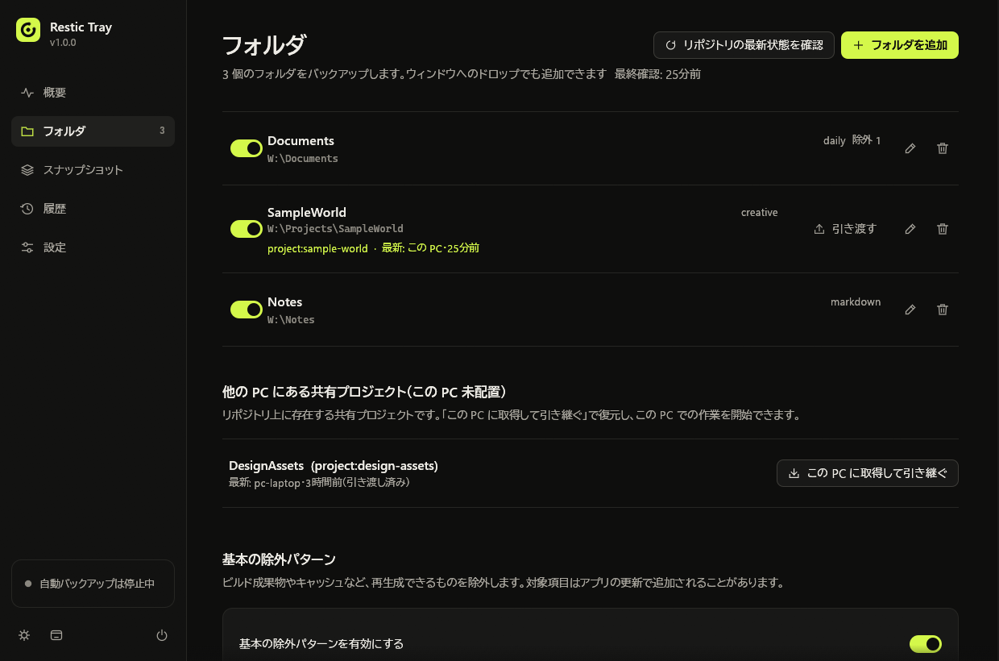
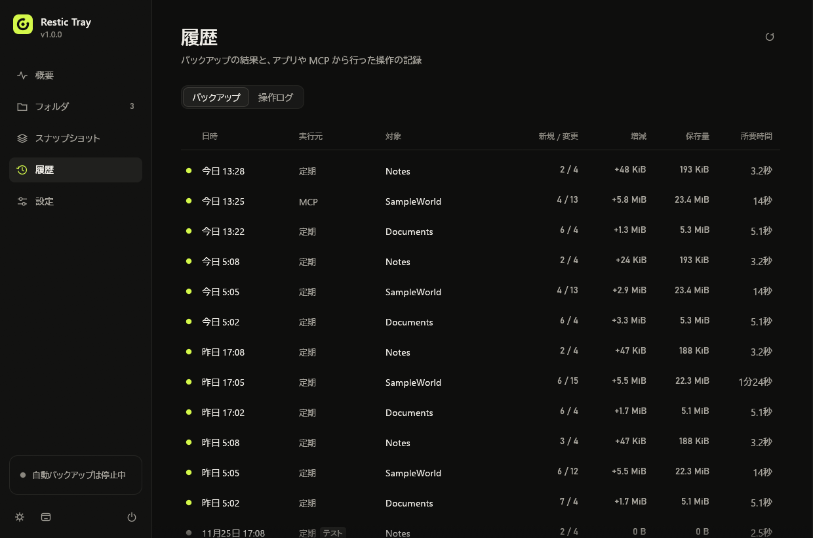
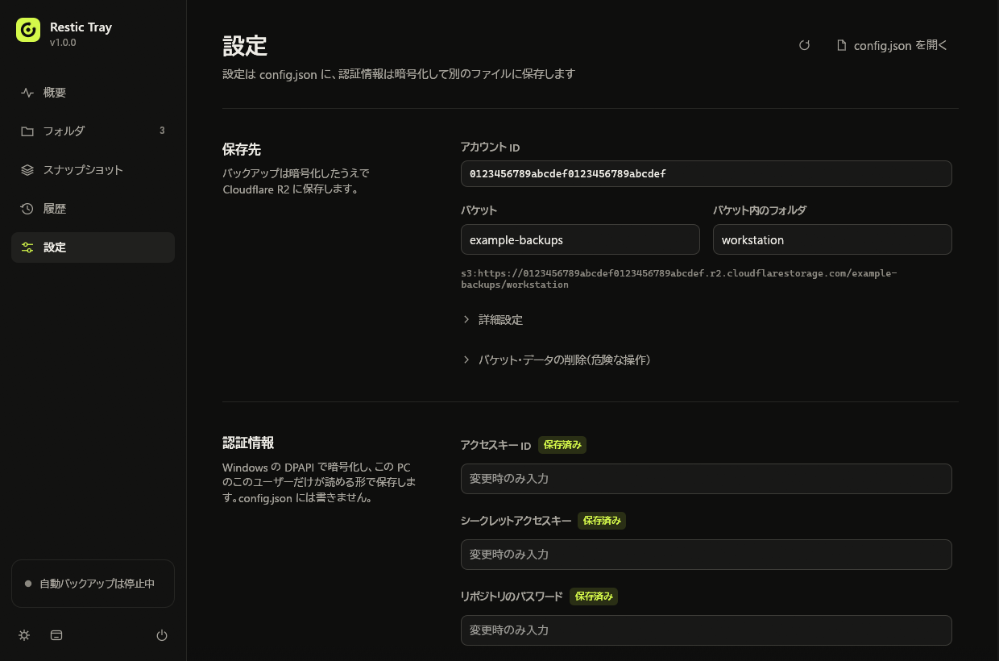

<p align="center">
  
</p>

<h1 align="center">Restic Tray</h1>

<p align="center">
  Cloudflare R2 と Restic を用いてクライアント側暗号化バックアップを定期実行する、22 ツール MCP サーバー内蔵の純 Rust 製 Windows タスクトレイ常駐アプリ。
</p>

<p align="center">
  <a href="LICENSE"></a>
  <a href="https://github.com/nayuengin/restic-tray/releases/latest"></a>
  <a href="https://github.com/nayuengin/restic-tray/actions/workflows/ci.yml"></a>
  
  <a href="Cargo.toml"></a>
  <a href="docs/AGENT.md"></a>
</p>

<p align="center">
  <a href="README.md">English</a> | <strong>日本語</strong>
  &nbsp;&middot;&nbsp;
  <a href="https://nayuengin.github.io/restic-tray/ja/">公式サイト</a>
  &nbsp;&middot;&nbsp;
  <a href="https://nayuengin.github.io/restic-tray/ja/docs/">ドキュメント</a>
</p>

---

Restic Tray は、Git が追わない作業途中のファイルやバイナリ素材も含めて作業フォルダを、利用者自身の Cloudflare R2 バケットへ定期的にバックアップします。データは送信前に PC 上で [restic](https://restic.net/) が暗号化します。保存先は標準の restic リポジトリなので、仮にこのアプリがなくなっても公式 `restic` コマンドだけで一覧表示と復元ができます。

> [!NOTE]
> - **非公式ソフトウェア**: Restic Tray は独立したオープンソースプロジェクトであり、[restic](https://restic.net/) および [Cloudflare](https://www.cloudflare.com/) とは一切関係がありません。
> - **画面言語**: デスクトップ GUI および内蔵 MCP ツールの説明文は現在 **日本語のみ** です（多言語化は未対応）。
> - **対応環境**: Windows 10 / Windows Server 2016 以降（x64）。同梱する `restic.exe`（v0.18.0 以降）の要件により、Windows 10 以降および TLS 1.2 以降が必須です。 **実験的**: コア部分は macOS / Linux でもビルド・動作します（Keychain / Secret Service による認証情報、Unix ソケットの MCP ブリッジ）。配布パッケージは引き続き Windows 用のみです。
> - **AI による運用管理**: 本リポジトリはオーナー（`@nayuengin`）の指揮のもと AI メンテナが管理しています（運用憲章: [`AGENTS.md`](AGENTS.md)）。AI を使ったコントリビューションも、PR での開示を条件に全面的に歓迎します（[`CONTRIBUTING.md`](CONTRIBUTING.md)）。

## スクリーンショット

架空のデモデータを用いた隔離環境で撮影しています（架空パス・自動バックアップ無効・実認証情報や外部通信なし）。

<p align="center">
  
</p>

<details>
<summary>その他の画面を見る（スナップショット・フォルダ・履歴・設定）</summary>

| スナップショット (`スナップショット`) | フォルダ (`フォルダ`) |
| :---: | :---: |
|  |  |

| 履歴 (`履歴`) | 設定 (`設定`) |
| :---: | :---: |
|  |  |

</details>

## なぜ Restic Tray か

### Git はバックアップではない

- **Git が残すのはコミット済みの履歴であり、今の作業フォルダではない**: 未コミットの編集、未追跡ファイル、stash、push していないブランチやコミットは、PC やドライブが故障すれば失われます。
- **フォルダ全体を `.git` ごと保存する**: Restic Tray は対象フォルダの中身を `.git` も含めて丸ごとスナップショットします（除外するのは Git の一時ファイル `.git/objects/pack/tmp_pack_*` のみ）。作業途中の状態もそのまま残ります。
- **守りたいものの多くは、そもそも Git に入っていない**: Unity プロジェクトの大きなバイナリ素材、リポジトリ化していない作業フォルダ、文書やメモなどです。restic は重複排除を行うため、毎日スナップショットを取っても変更されたチャンクしか送信しません。
- **再生成できるものは送らない**: 依存・ビルドキャッシュ（`node_modules/`、`target/`、`.venv/` 等）や、各 Unity プロジェクト直下の `Library`、`Temp`、`Logs`、`obj`、`Build`、`Builds`、`Assets\SerializedUdonPrograms` は既定で除外し、保存容量と転送時間を「作り直せない作業データ」に使います。生成物も残したい場合は基本の除外パターン（`useBasicExcludes`）をオフにできます。
- **リモート Git だけではバックアップにならない**: force push や誤削除でリモート履歴は消えます。バックアップは独立したコピーとして、自分で決めた保持世代（`keepLast`、`keepDaily`、`keepWeekly`、`keepMonthly`）を守ります。
- **役割を分けて併用する**: 共同作業とコード履歴は Git に任せ、「火曜日の時点のフォルダに戻したい」を Restic Tray が受け持ちます（複数 PC 引き継ぎの `projectKey` は Git 管理外プロジェクト向けで、`.git` を含むフォルダには付与できません）。

### なぜ restic か

- **送信前に PC 上で暗号化する**: restic はすべてのデータとメタデータを AES-256-CTR と Poly1305-AES MAC で暗号化・認証し、鍵はパスワードから `scrypt` で導出します（[restic 暗号化設計](https://restic.readthedocs.io/en/stable/100_references.html#encryption)）。R2 に置かれるのは暗号文だけであり、リポジトリパスワードは PC の外に出ません。Restic Tray は認証情報を Windows DPAPI で保護し、`restic.exe` へは環境変数でのみ渡します。
- **重複排除で差分だけ送信**: 変わったチャンクだけを送りつつ、どのスナップショットもその時点の完全なフォルダツリーとして扱えます。
- **中身を見て、比べて、選んで戻せる**: スナップショット画面や MCP（`list_snapshot_files`、`diff_snapshots`、`includePaths` 付き `restore_snapshot`）で差分確認と部分復元ができます。
- **壊れていないか実際に読み戻して確かめる**: `restic check --read-data-subset` で保存データの一部を実際に読み戻して検証します。Restic Tray は既定で 7 日ごとに 5% を自動確認し、異常があれば Windows 通知で知らせます。
- **アプリに縛られない**: 標準の restic リポジトリ（BSD 2-Clause OSS）のため、Restic Tray がなくても公式 `restic` コマンドだけで一覧確認と復元ができます（「[Restic Tray なしで復元する](#restic-tray-なしで復元する)」を参照）。

### なぜ Cloudflare R2 か

- **S3 互換でそのまま使える**: restic 標準の `s3:` バックエンドで直接接続でき、中継ツールや追加の同期レイヤが不要です。
- **取り出し（エグレス）料金がかからない**: Cloudflare R2 はデータ取り出しの帯域課金がありません（[Cloudflare R2 Pricing](https://developers.cloudflare.com/r2/pricing/)）。復元や定期的な読み戻し確認でも転送料を気にせず運用できます。
- **バケットも鍵も利用者のもの**: 作者が運営するサーバーは存在せず、テレメトリや更新確認などの外部通信も行いません。

### なぜトレイ常駐と MCP か

- **低負荷な常駐スケジューラ**: 定期バックアップには常駐が必要ですが、トレイ格納中は描画ループを止めて CPU 消費をほぼゼロに抑えます（インストーラの試験ではトレイ格納中 10 秒間の CPU 時間が 1 秒以下であることを検証しています）。
- **ひと目で分かる保護状態と未実施アラート**: 概要画面で「最後に成功してからの経過時間」と直近 7 日間の 1 時間単位グリッドを表示し、成功が途絶えたら（既定 48 時間）Windows トースト通知で知らせます。
- **AI コーディングエージェントとの連携**: Claude Code や Cursor などの MCP クライアントが、危険な作業の前にバックアップ状態を確認し、テスト実行や安全な復元を行えます（破壊的操作や Prune に関わる設定変更は既定で無効です）。

## 主な特徴

- **Cloudflare R2（S3 互換）+ Restic 暗号化バックアップ**: Restic ネイティブの S3 互換バックエンド経由で、クライアント側暗号化・重複排除付きのスナップショットを Cloudflare R2 へ保存します。配布インストーラ／ZIP には、SHA-256 を検証済みの固定バージョン公式 `restic.exe`（v0.20.0）を同梱します（[`scripts/download-restic.ps1`](scripts/download-restic.ps1)）。
- **タスクトレイ常駐 & 極小リソース消費**: WebView を使わない純 Rust（`eframe` / `egui` 0.37 + `tray-icon` 0.26）構成。ウィンドウを閉じたり最小化してもタスクトレイに常駐し、格納中の CPU 消費を抑えながら定期スケジューラと MCP ブリッジが稼働します。
- **Windows DPAPI + Zeroize による秘密情報保護**: Cloudflare R2 の `Access Key ID` / `Secret Access Key` と Restic リポジトリパスワードは `config.json` に一切書き込まず、Windows DPAPI（`CryptProtectData` + 二次エントロピー + `Zeroize`）で暗号化して `config\credentials.dat` に分離保存します。`restic.exe` 起動時もコマンドライン引数には渡さず、環境変数経由でのみ注入します。
- **AI エージェント向け MCP サーバー内蔵 (`restic-tray.exe --mcp`)**: 常駐アプリと Windows 名前付きパイプ（`reject_remote_clients(true)` + 256-bit 相互トークン認証）で通信する **22 個の MCP ツール** を提供。常駐アプリが未起動でもヘッドレスフォールバックで動作します。
- **GUI と JSON の双方向設定 (`config.json`)**: バックアップ対象フォルダ（ドラッグ＆ドロップ対応）、組み込みの基本除外パターン（`useBasicExcludes`）・Unity プロジェクト直下除外・目印ファイルによる除外（`excludeIfPresent`）、定期スケジュール（間隔指定または毎日時刻 `schedule.dailyAt`）、定期復元確認（`verifyEveryDays` / `verifyReadPercent`）、未実施アラート通知（`notifyOverdueHours`）、スナップショット容量内訳、保持世代ポリシー（`keepLast` / `keepDaily` / `keepWeekly` / `keepMonthly`）を GUI からも `config.json` からも管理できます。
- **ローカル SQLite (WAL) 実行履歴 & MCP 監査ログ**: バックアップの実行結果（新規・変更件数、前回比の増減、保存量、Snapshot ID、所要時間）と、GUI・トレイ・MCP からの操作監査ログを `r2_restic_history.db` に記録します。
- **安全な R2 データ／バケット削除**: 内蔵の純 Rust S3 API クライアントにより、プレフィックス配下削除またはバケット全体の空化・削除に対応。GUI では Dry-Run 事前集計・バケット名手入力・1.5 秒長押しボタンによる多段誤操作防止を備えています。
- **ダーク / ライト 2 テーマ**: 墨色と紙色の無彩色にライムを 1 色だけ配した高コントラスト設計（コントラスト比 4.5:1 以上、全アイコンは `egui::Painter` ベクター描画）。
- **複数 PC 共有プロジェクトと引き継ぎ *(実験的機能)***: 単一ライター運用（`projectKey` / `writerState` / `release_project` / `takeover_project`）とサブパス読み替え復元・退避スナップショットに対応しています。長期の定期実行運用での実績がまだ限られるため、現時点では実験的機能として提供しています。

## ほかの方法との比較

| 項目 | Restic Tray | `restic` コマンドとタスクスケジューラ |
| :--- | :--- | :--- |
| **設定の方法** | 画面と `config.json` | コマンド、環境変数、スクリプト |
| **秘密情報の保存** | Windows DPAPI（`credentials.dat`）で暗号化 | 利用者が用意する |
| **R2 の接続先** | 画面入力から URL を自動組み立て | URL と環境変数を手で書く |
| **Unity を考えた除外** | 既定で組み込み（プロジェクト直下・目印ファイル） | 自分で除外リストを書く |
| **失敗・未実施の通知** | Windows 通知（既定 48 時間） | 自分で用意する |
| **定期的な読み戻し確認** | 既定で 7 日ごとに 5% を自動検証 | 別にタスクを設定する |
| **AI エージェント操作** | 22 ツール内蔵 MCP サーバー（`--mcp`） | なし |
| **対応 OS と保存先** | Windows 10 以降 x64 と Cloudflare R2 のみ | restic が対応するすべて |

`restic` コマンドとタスクスケジューラを直接組み上げて運用できる人には、CLI だけで足ります。Restic Tray は、Windows から Cloudflare R2 への暗号化定期バックアップを手早く安全に始めたい人のためのアプリです。

## インストール

### GitHub Releases から導入（Windows x64）

[GitHub Releases](https://github.com/nayuengin/restic-tray/releases/latest) から利用形態に合うパッケージをダウンロードしてください（いずれも公式 `restic.exe` v0.20.0 を同梱しています。実行には Windows 10 / Windows Server 2016 以降および TLS 1.2 以降が必要です）。

| 配布形式 | ファイル名 | 特徴 |
| :--- | :--- | :--- |
| **NSIS インストーラ（推奨）** | `Restic.Tray_<version>_x64-setup.exe` | `%LOCALAPPDATA%\Programs\Restic Tray` へユーザー単位で導入。常駐アプリや `--mcp` 起動中でも安全に上書き更新可能。 |
| **MSI インストーラ** | `Restic.Tray_<version>_x64_ja-JP.msi` | Windows Installer 形式（ユーザー単位導入）。 |
| **Portable ZIP** | `Restic.Tray_<version>_x64-portable.zip` | 任意のフォルダに展開して `restic-tray.exe` を直接実行。 |

#### SmartScreen 警告と配布物の検証（チェックサム & 来歴証明）

> [!IMPORTANT]
> 初期リリースは **コード署名なし（未署名）** で配布されます。初回実行時に Windows Defender SmartScreen の警告（「Windows によって PC が保護されました」）が表示される場合があります（検証後に「詳細情報」→「実行」で起動できます）。また Windows 11 の **Smart App Control** が有効な環境では未署名バイナリがブロックされる場合があります。実行前に必ず `SHA256SUMS.txt` と GitHub Artifact Attestations で配布物を確認してください。

```powershell
# 1. 同じリリースの SHA256SUMS.txt と照合する
Get-FileHash -Algorithm SHA256 .\Restic.Tray_1.0.0_x64-setup.exe
Get-Content .\SHA256SUMS.txt

# 2. GitHub Artifact Attestation（ビルド来歴証明）を検証する（GitHub CLI `gh` が必要）
gh attestation verify .\Restic.Tray_1.0.0_x64-setup.exe --repo nayuengin/restic-tray
```

### Cloudflare R2 を準備する

Restic Tray を設定する前に、Cloudflare ダッシュボードで R2 バケットと最小権限の API トークンを用意します。

1. **R2 Object Storage → Overview → Create bucket** からバックアップ専用バケットを作成します（例: `my-restic-backups`）。
2. **Account Details**（または URL `https://dash.cloudflare.com/<ACCOUNT_ID>/r2/...`）から 32 文字の **Account ID** を確認します。
3. **Account Details → API Tokens → Manage** から **Account API token** を作成します。権限は **Object Read & Write** を選び、**Apply to specific buckets only** で対象バケットのみに限定することを推奨します。完了画面で **Access Key ID** と **Secret Access Key** を控えてください（1 度しか表示されません）。
   - *補足*: バケット限定の `Object Read & Write` トークンで、バックアップ・復元・世代整理・プレフィックス削除・バケット空化まですべて実行できます。アプリからバケット本体まで一括削除したい場合のみ `Admin Read & Write` 権限が必要です（通常は空化後にダッシュボードでバケットを削除してください）。

詳しい手順・入力項目の対応表・トークン漏洩時のローテーション方法は [`docs/CLOUDFLARE_R2_SETUP.md`](docs/CLOUDFLARE_R2_SETUP.md) を参照してください。

### ソースからビルド

**前提環境（Windows x64）:**
- Windows 10 / Windows Server 2016 以降（x64）および TLS 1.2 以降（同梱 `restic.exe` v0.18.0 以降の必須要件）
- Rust stable（MSRV **1.95**、`x86_64-pc-windows-msvc`）および Visual Studio C++ ビルドツール
- PowerShell 7（`pwsh`）
- インストーラもビルドする場合: `PATH` 上に NSIS（`makensis.exe`）と WiX Toolset 3.14（`candle.exe` / `light.exe`）、アイコン・ライセンス表記再生成用に Python 3（標準ライブラリのみ）

```powershell
git clone https://github.com/nayuengin/restic-tray.git
cd restic-tray

# 固定バージョンの公式 restic.exe (v0.20.0) を取得し SHA-256 検証のうえ binaries/restic.exe へ配置
pwsh -NoProfile -File scripts/download-restic.ps1

# 開発起動
cargo run

# リリースビルド (target/release/restic-tray.exe)
cargo build --release --locked
```

## クイックスタート

1. **Restic Tray** を起動し、左メニューの **設定** を開きます。
2. **保存先** に Cloudflare R2 の **アカウント ID**、**バケット**、必要に応じて **バケット内のフォルダ（プレフィックス）** を入力して **保存**（`Ctrl+S`）します。
3. **認証情報** に R2 の **アクセスキー ID**・**シークレットアクセスキー** と、バックアップ暗号化用の強力な **リポジトリのパスワード** を入力して **認証情報を保存** します（Windows DPAPI で暗号化保存）。
   > [!WARNING]
   > **リポジトリのパスワードは必ずアプリとは別の場所（パスワード管理ツールやオフラインの控え）にも保管してください。**
   > `config\credentials.dat` は Windows DPAPI でその PC のその Windows ユーザーに紐づけて暗号化されるため、PC の故障・紛失や Windows 再インストール時には復号できません。R2 の API トークンは再発行できますが、**リポジトリのパスワードを失うと R2 上の暗号化バックアップは二度と復元できません**。
4. **リポジトリを作成**（既存リポジトリを使う場合は **接続を確認**）を実行します。
5. **フォルダ** 画面で **フォルダを追加** を押すか、対象フォルダをウィンドウへドラッグ＆ドロップします。
6. **概要** 画面で **テスト実行**（Dry-Run）により除外設定を確認したうえで **今すぐバックアップ** を実行し、問題なければ **設定 → スケジュール** を有効化します。

### Windows サインイン時の自動起動

現時点では、アプリ側で Windows の自動起動を登録する機能はありません。**定期バックアップと未実施通知はアプリが起動している間だけ動作する**ため、PC 再起動後にアプリを起動しないままだと、気づかないうちにバックアップが止まります。

Windows へのサインイン時にトレイへ格納した状態で自動起動させるには、次の手順でスタートアップへショートカットを置いてください。

1. `Win + R` を押し、`shell:startup` と入力して **Enter** を押し、スタートアップフォルダを開きます。
2. `restic-tray.exe` に `--minimized` 引数を付けたショートカットを作成します。
   - リンク先: `"%LOCALAPPDATA%\Programs\Restic Tray\restic-tray.exe" --minimized`（Portable ZIP 版の場合は展開先のパスに読み替えてください）

## データを復元する

### アプリの画面から復元する

1. 左メニューの **スナップショット** を開き、**R2 から読み込む** を押して一覧を取得します。
2. 左の一覧から復元したいスナップショットを選びます。必要に応じて **ファイル一覧を表示** や **差分を表示** で中身を確認できます。
3. **復元** セクションの **復元先フォルダ** に、**元の場所とは別の安全なフォルダ**（例: `D:\Restore\2026-11-26`）を指定します。ドライブ直下（`C:\`）や `C:\Windows`・`C:\Program Files` などのシステム領域は自動的に拒否されます。
   - 復元先フォルダの下には、元のドライブ文字を含む階層構造でファイルが展開されます（例: `D:\Projects\SampleWorld` のスナップショットを `D:\Restore` へ復元すると `D:\Restore\D\Projects\SampleWorld\...` に配置されます）。
4. 一部だけ復元したい場合は、**一部だけ復元する（任意）** にスナップショット内のパス（例: `/D/Projects/SampleWorld/notes`）をカンマ区切りで入力します（空欄なら全体復元）。MCP からは `restore_snapshot` の `includePaths` で同じ操作ができます。
5. **復元する** を押して確認ダイアログで確定します。

### 新しい PC で復旧する（PC 紛失・故障時）

1. 新しい PC に Restic Tray をインストールします。
2. **設定 → 保存先** に、元の PC と同じ Cloudflare R2 の **アカウント ID**・**バケット**・**バケット内のフォルダ** を入力して保存します。
3. **設定 → 認証情報** に、有効な R2 API トークン（Cloudflare ダッシュボードで新しく発行したもので構いません）と、**別に控えておいた元のリポジトリのパスワード** を入力して保存します。
4. **接続を確認** でリポジトリへ接続できることを確かめたあと、**スナップショット** 画面から復元します。

## Restic Tray なしで復元する

保存先は標準の restic リポジトリのため、Restic Tray がなくても公式 `restic` コマンドだけで復元できます。

1. [restic/restic Releases](https://github.com/restic/restic/releases) から Windows 版の公式 `restic.exe` を入手します。
2. PowerShell で、現在のセッションの環境変数に R2 の接続先とアクセスキーを設定します。
   ```powershell
   $env:AWS_ACCESS_KEY_ID = "<R2 のアクセスキー ID>"
   $env:AWS_SECRET_ACCESS_KEY = "<R2 のシークレットアクセスキー>"
   $env:AWS_DEFAULT_REGION = "auto"
   $env:RESTIC_REPOSITORY = "s3:https://<アカウント ID>.r2.cloudflarestorage.com/<バケット名>/<プレフィックス>"
   ```
   > [!TIP]
   > リポジトリのパスワードは `$env:RESTIC_PASSWORD` に書かず、`restic` 実行時の対話プロンプトで入力してください（コマンドラインに秘密値を書くと PowerShell の履歴に残るためです）。プレフィックスを使っていない場合は末尾の `/<プレフィックス>` を省きます。
3. スナップショット一覧を確認し、別のフォルダへ復元します。
   ```powershell
   .\restic.exe snapshots
   .\restic.exe restore <スナップショット ID> --target D:\Restore
   ```
   復元されたファイルは `D:\Restore\<ドライブ文字>\<元のパス>\...` 配下に展開されます。

## MCP 統合（`--mcp`）

`restic-tray.exe --mcp` は [Model Context Protocol (MCP)](https://modelcontextprotocol.io/) の stdio JSON-RPC 2.0 サーバーとして動作し、**全 22 ツール** を提供します。

| カテゴリ | ツール |
| :--- | :--- |
| **状態確認・履歴** | `get_status`, `get_config`, `get_backup_history`, `list_snapshots`, `list_snapshot_files`, `diff_snapshots`, `get_size_breakdown` |
| **バックアップ・検査** | `run_backup`, `cancel_backup`, `init_repository`, `check_repository` |
| **設定・対象管理** | `update_storage_config`, `add_backup_target`, `remove_backup_target`, `update_schedule`, `update_retention_policy` |
| **復元・破壊的操作 *(保護付き)*** | `restore_snapshot`, `forget_prune`, `delete_r2_bucket` |
| **複数 PC 引き継ぎ *(実験的)*** | `get_project_sync_status`, `release_project`, `takeover_project` |

**安全な初期設定**: MCP からは秘密情報を一切返却・受理しません。破壊的操作（`forget_prune`, `delete_r2_bucket`, `takeover_project`）は初期状態で無効（`agent.allowPrune: false`, `agent.allowDeleteStorage: false`, `agent.allowHandoff: false`）かつ既定 `dryRun: true` で、本実行には明示的な確認パラメータが必要です。`agent.allowPrune: false` のときは、保持ポリシー変更（`update_retention_policy`）、`update_schedule` での `autoPruneAfterBackup` 有効化・`maintenanceAt` の新規設定／変更、および MCP 起点バックアップ後の自動 Prune も抑止されます。一方、`restore_snapshot` は既定で有効（`agent.allowRestore: true`）ですが、元の場所を上書きせず別の検証済みフォルダ（`targetDir`）へ戻す操作です。

### Claude Code への登録

```powershell
claude mcp add --scope user restic-tray -- "$env:LOCALAPPDATA\Programs\Restic Tray\restic-tray.exe" --mcp
```

### `mcpServers` JSON 設定（Claude Desktop / Cursor 等）

```json
{
  "mcpServers": {
    "restic-tray": {
      "command": "C:\\Users\\<ユーザー名>\\AppData\\Local\\Programs\\Restic Tray\\restic-tray.exe",
      "args": ["--mcp"]
    }
  }
}
```

全ツールの詳細な引数と仕様は [`docs/AGENT.md`](docs/AGENT.md) を参照してください。

## 設定の概要

実行時データはユーザーごとに `%LOCALAPPDATA%\io.github.nayuengin.restic-tray\` 配下へ保存されます。

| ファイル | 役割 |
| :--- | :--- |
| `config.json` | 非秘密の設定（R2 保存先 `r2`、対象フォルダ `targets`、除外設定 `useBasicExcludes` / `globalExcludes` / `excludeIfPresent`、スケジュール `schedule`、保持ルール `retention`、MCP ポリシー `agent`、テーマ） |
| `config\credentials.dat` | Windows DPAPI 暗号化済みの R2 アクセスキー ID・シークレットアクセスキー・Restic リポジトリパスワード |
| `r2_restic_history.db` | バックアップ履歴・MCP/GUI 監査ログ・複数 PC 同期状態を記録する SQLite (WAL) データベース |
| `agent-bridge.json` | 常駐アプリ起動中のみ書き出される一時名前付きパイプ名と 256-bit 相互認証トークン |

> Restic Tray をアンインストールしても `%LOCALAPPDATA%\io.github.nayuengin.restic-tray\` と Cloudflare R2 上のバックアップデータは削除されません。完全に消去したい場合は手動で削除してください。

## よくある質問

<details>
<summary>Windows を起動したら自動で動きますか？</summary>

現時点では自動登録されません。定期バックアップと未実施通知はアプリが動いている間だけ働くため、`Win + R` → `shell:startup` に `restic-tray.exe --minimized` のショートカットを置いてください（[Windows サインイン時の自動起動](#windows-サインイン時の自動起動)）。

</details>

<details>
<summary>PC をなくしたら復元できますか？ パスワードを忘れたらどうなりますか？</summary>

リポジトリのパスワードを別の場所に控えてあれば、新しい PC から復元できます（R2 の API トークンは Cloudflare ダッシュボードで再発行できます）。`credentials.dat` は元の PC のその Windows ユーザーでしか復号できないため、パスワードを忘れると R2 上のバックアップは二度と復元できません。

</details>

<details>
<summary>Cloudflare はバックアップしたファイルの中身を読めますか？</summary>

読めません。ファイルの中身・ファイル名・メタデータはすべて送信前に PC 上で restic が暗号化し、パスワードは PC の外に出ません。

</details>

<details>
<summary>Unity の <code>Library</code> フォルダがバックアップに入っていないのはなぜですか？</summary>

Unity プロジェクト直下の `Library`、`Temp`、`Logs`、`obj`、`Build`、`Builds`、`Assets\SerializedUdonPrograms` は再生成できるキャッシュのため、容量と転送時間を節約する目的で既定で除外しています（`useBasicExcludes: true`）。`Assets` や `Packages` 内の同名フォルダは除外されません。生成物も残したい場合は **フォルダ** 画面で **基本の除外パターンを有効にする** をオフにしてください。

</details>

<details>
<summary>Git のリポジトリもバックアップできますか？</summary>

できます。`.git` を含めてフォルダ全体が保存されます（除外されるのは一時ファイル `.git/objects/pack/tmp_pack_*` のみ）。ただし複数 PC の引き継ぎ機能（`projectKey`）は `.git` を含むフォルダには使えないため、コードの同期は Git で行ってください。

</details>

<details>
<summary>Cloudflare R2 の料金はどのくらいかかりますか？</summary>

最新の無料枠と単価は [Cloudflare R2 Pricing](https://developers.cloudflare.com/r2/pricing/) を参照してください。R2 はエグレス（取り出し）料金が無料で、restic の重複排除と基本の除外パターンにより保存容量も抑えられます。

</details>

<details>
<summary>インストーラで Windows SmartScreen の警告が出るのはなぜですか？</summary>

初期リリースはコード署名なしで配布しているためです。実行前に「[SmartScreen 警告と配布物の検証](#smartscreen-警告と配布物の検証チェックサム--来歴証明)」の手順で `SHA256SUMS.txt` と `gh attestation verify` を確認してください。

</details>

<details>
<summary>Cloudflare R2 以外の保存先、macOS/Linux、英語 UI に対応予定はありますか？</summary>

現在の対応範囲は Windows 10 / Windows Server 2016 以降（x64、TLS 1.2 以降必須）・Cloudflare R2・日本語 UI です。範囲外の要望も GitHub Issues でアイデアとして受け付けていますが、実装は約束していません。

</details>

<details>
<summary>自分の R2 バケット以外にデータを送信しますか？</summary>

送信しません。作者運営のサーバー、テレメトリ、更新確認通信はいずれもありません。

</details>

<details>
<summary>新しいバージョンが出たことをどう知ればよいですか？</summary>

アプリ内に自動更新確認はありません。GitHub リポジトリ [nayuengin/restic-tray](https://github.com/nayuengin/restic-tray) の上部にある **Watch → Custom → Releases** を有効にすると新リリースの通知を受け取れます。

</details>

## ドキュメント

- [公式サイト・オンラインドキュメント](https://nayuengin.github.io/restic-tray/ja/)（[ドキュメント一覧](https://nayuengin.github.io/restic-tray/ja/docs/)）— 導入・チェックサム照合・Cloudflare R2 初期設定・基本操作・MCP 統合・復元手順・トラブルシューティング・FAQ（日本語 / English）
- [`README.md`](README.md) — 英語版 README
- [`docs/CLOUDFLARE_R2_SETUP.md`](docs/CLOUDFLARE_R2_SETUP.md) — Cloudflare R2 バケット・API トークン作成とアプリ設定手順
- [`docs/ARCHITECTURE.md`](docs/ARCHITECTURE.md) — モジュール責務・R2/Restic 接続方式・MCP 信頼境界・複数 PC 引き継ぎ設計
- [`docs/AGENT.md`](docs/AGENT.md) — 全 22 個の MCP ツール仕様
- [`CHANGELOG.md`](CHANGELOG.md) — 変更履歴と移行手順

## サポート方針と免責

- **サポート対象バージョン**: **最新リリースのみ** を対象とします。過去バージョンへの修正のバックポートは行いません。
- **SLA なし**: ベストエフォートでの運用であり、返信や修正の期限（SLA）は約束しません。
- **セマンティックバージョニング**: [Semantic Versioning](https://semver.org/) に従い、破壊的変更はメジャーバージョンでのみ行います。変更内容と移行手順は [`CHANGELOG.md`](CHANGELOG.md) に記載します。
- **対応範囲**: Windows 10 / Windows Server 2016 以降（x64、TLS 1.2 以降必須）・Cloudflare R2・日本語 UI を前提としています。範囲外の要望（他 OS・他保存先・多言語化等）はアイデアとして受け付けますが、実装は約束しません。
- **バックアップ内容の免責**: MIT ライセンスの無保証条項に加え、**本アプリはバックアップの完全性および復元可能性を保証しません**。定期的な復元確認機能や手動のテスト復元により、復元できることを利用者自身で確認してください。

## 参加・セキュリティ

- **運用体制**: 本リポジトリはオーナー（`@nayuengin`）の指揮のもと AI メンテナが管理しています。AI メンテナの責務と権限境界は [`AGENTS.md`](AGENTS.md) に定めています。
- **コントリビューション**: Issue の作成や PR の手順は [`CONTRIBUTING.md`](CONTRIBUTING.md) および [`CODE_OF_CONDUCT.md`](CODE_OF_CONDUCT.md) を確認してください。小さな修正やドキュメント改善は直接 PR 歓迎です。機能追加や大きな変更は先に Issue で相談してください。AI によるコーディングも、使用した AI と担当範囲を PR で開示することを条件に全面的に歓迎します。
- **セキュリティ報告**: 脆弱性は公開 Issue ではなく、[`SECURITY.md`](SECURITY.md) に記載の GitHub Private Vulnerability Reporting から非公開で報告してください。

## ライセンス

[MIT License](LICENSE) のもとで公開されています。
同梱する `restic.exe`（BSD 2-Clause）および静的リンクされる依存クレートのライセンス表記は [`THIRD_PARTY_NOTICES.md`](THIRD_PARTY_NOTICES.md) を参照してください。
