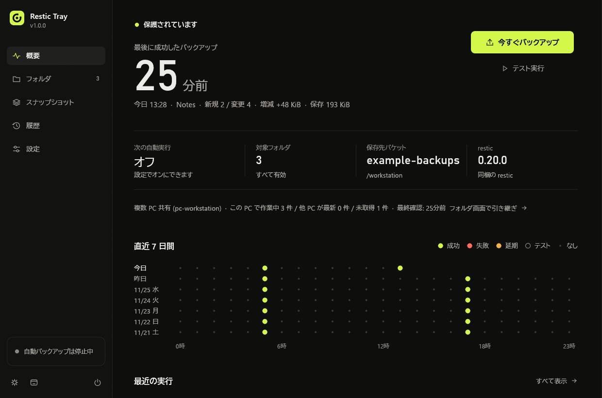
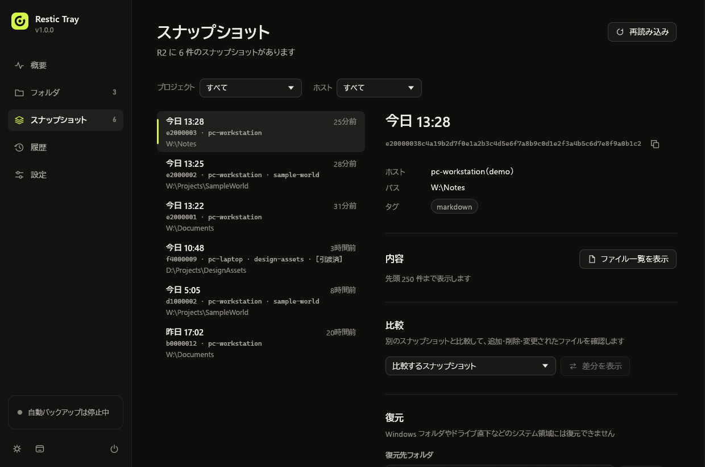
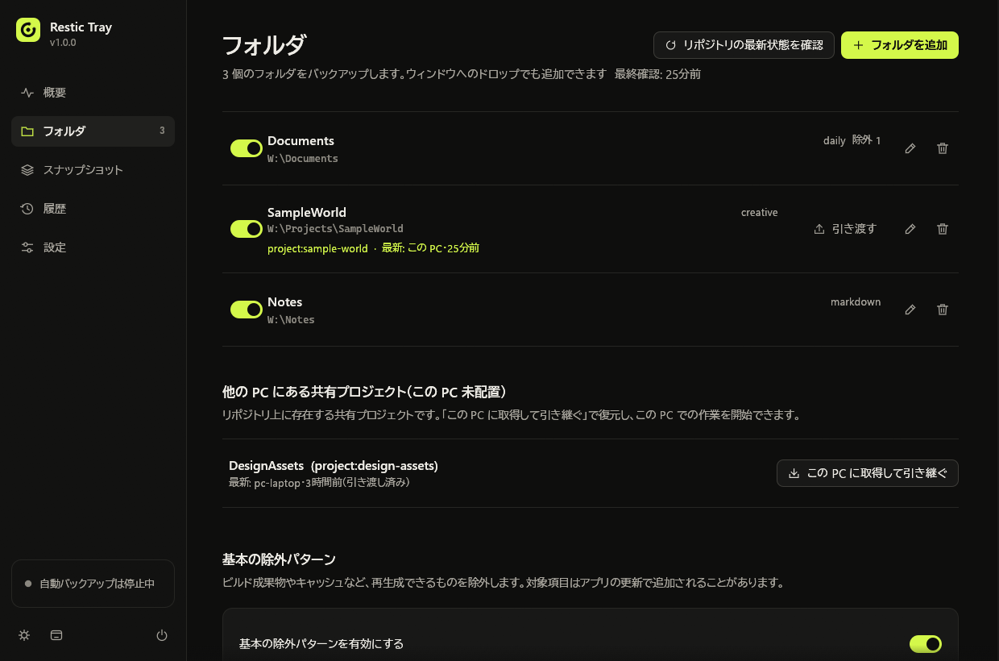
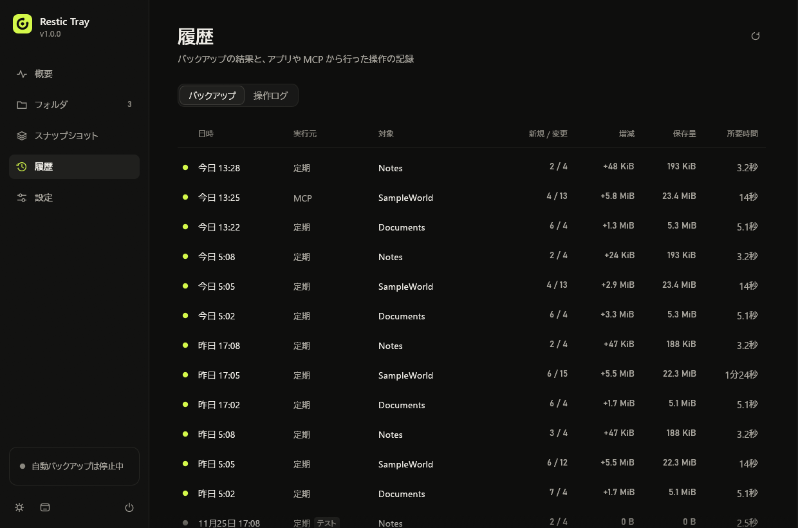
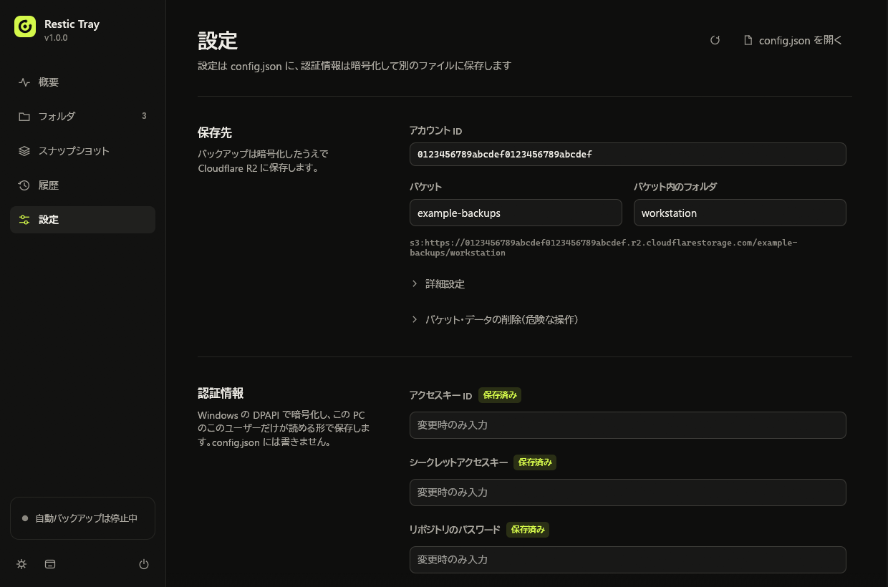

<p align="center">
  
</p>

<h1 align="center">Restic Tray</h1>

<p align="center">
  Pure-Rust Windows system tray app for client-side encrypted periodic backups to Cloudflare R2 with Restic and a built-in 22-tool MCP server.
</p>

<p align="center">
  <a href="LICENSE"></a>
  <a href="https://github.com/nayuengin/restic-tray/releases/latest"></a>
  <a href="https://github.com/nayuengin/restic-tray/actions/workflows/ci.yml"></a>
  
  <a href="Cargo.toml"></a>
  <a href="docs/AGENT.md"></a>
</p>

<p align="center">
  <strong>English</strong> | <a href="README.ja.md">日本語</a>
  &nbsp;&middot;&nbsp;
  <a href="https://nayuengin.github.io/restic-tray/">Website</a>
  &nbsp;&middot;&nbsp;
  <a href="https://nayuengin.github.io/restic-tray/docs/">Documentation</a>
</p>

---

Restic Tray periodically backs up your working folders — including uncommitted changes, binary assets, and non-Git projects — to your own Cloudflare R2 bucket, encrypted client-side on your PC by [restic](https://restic.net/) before upload. Because the destination is a standard restic repository, you can inspect and restore your backups directly with the `restic` CLI even if this app no longer exists.

> [!NOTE]
> - **Unofficial software**: Restic Tray is an independent open-source project and is not affiliated with, endorsed by, or sponsored by [restic](https://restic.net/) or [Cloudflare](https://www.cloudflare.com/).
> - **UI language**: The desktop GUI and built-in MCP tool descriptions are currently **Japanese only**. Localization is not yet implemented.
> - **Platform**: Windows 10 / Windows Server 2016 or later (x64) only, with TLS 1.2 or later required (required by bundled `restic.exe` v0.18.0+).
> - **AI-operated maintenance**: This repository is managed by AI maintainers under the owner's (`@nayuengin`) direction (see [`AGENTS.md`](AGENTS.md)). AI-assisted contributions are welcome with PR disclosure (see [`CONTRIBUTING.md`](CONTRIBUTING.md)).

## Screenshots

Captured in an isolated environment using synthetic demo data (fictional paths, auto-backup disabled, no real credentials or network access).

<p align="center">
  
</p>

<details>
<summary>More screenshots (Snapshots, Folders, History, Settings)</summary>

| Snapshots (`スナップショット`) | Folders (`フォルダ`) |
| :---: | :---: |
|  |  |

| History (`履歴`) | Settings (`設定`) |
| :---: | :---: |
|  |  |

</details>

## Why Restic Tray?

### Git is not a backup

- **Git records committed history, not your live working directory**: Uncommitted edits, untracked files, stashes, and unpushed branches are lost if your drive fails.
- **Entire folders are snapshotted, including `.git`**: Restic Tray backs up everything inside each folder (skipping only Git's temporary `.git/objects/pack/tmp_pack_*` pack files), so work in progress is preserved as-is.
- **Most valuable files are not in Git**: Large binary assets in Unity projects, non-Git workspaces, creative projects, and local notes rarely belong in Git. Restic deduplicates data at the chunk level, so daily snapshots upload only what changed.
- **Regenerable outputs stay out of your bucket**: Dependency and build caches (`node_modules/`, `target/`, `.venv/`, etc.) and Unity project-root generated folders (`Library`, `Temp`, `Logs`, `obj`, `Build`, `Builds`, `Assets\SerializedUdonPrograms`) are excluded by default so storage and upload time go to irreplaceable work. You can turn off built-in excludes (`useBasicExcludes`) if you want generated outputs backed up as well.
- **A Git host is not an independent backup**: Force-pushes, accidental branch deletion, or repository removal wipe remote history. Backups are an independent copy governed by your own retention policy (`keepLast`, `keepDaily`, `keepWeekly`, `keepMonthly`).
- **Use each tool for its strength**: Keep Git for collaboration and source history, and let Restic Tray answer *"give me this folder back as it was on Tuesday."* (Multi-PC handoff via `projectKey` is designed for non-Git projects and explicitly rejects folders containing `.git`.)

### Why restic

- **Client-side encryption before upload**: Restic encrypts all data and metadata on your PC using AES-256-CTR with Poly1305-AES authentication and `scrypt` key derivation ([restic encryption design](https://restic.readthedocs.io/en/stable/100_references.html#encryption)). Only ciphertext is stored in R2; your repository password never leaves your machine. Restic Tray stores credentials with Windows DPAPI and passes them to `restic.exe` only through environment variables.
- **Deduplicated point-in-time snapshots**: Only changed chunks are uploaded, while every snapshot remains independently browsable and restorable as a complete folder tree.
- **Inspect, diff, and selectively restore**: Browse files, diff two snapshots, and restore either an entire snapshot or specific subpaths from the GUI or via MCP (`list_snapshot_files`, `diff_snapshots`, `restore_snapshot` with `includePaths`).
- **Automated restore verification**: `restic check --read-data-subset` downloads and verifies a slice of stored data. Restic Tray checks 5% every 7 days by default and notifies you via Windows toast if any error is found.
- **No app lock-in**: Backups are stored in standard restic repository format (BSD 2-Clause open source), so you can always list and restore them using the official `restic` CLI alone (see [Recover Without Restic Tray](#recover-without-restic-tray)).

### Why Cloudflare R2

- **Native S3-compatible backend**: Works directly with restic's built-in `s3:` backend — no proxy or extra sync layer required.
- **Zero egress fees**: Cloudflare R2 charges no egress (download bandwidth) fees ([Cloudflare R2 Pricing](https://developers.cloudflare.com/r2/pricing/)), so full restores and periodic read-back verification do not trigger download surcharges.
- **Your bucket, your keys**: There is no backend server operated by the author, no telemetry, and no update-check phone-home traffic.

### Why a tray app with an MCP server

- **Low-overhead background scheduling**: Periodic backups need a resident process. When minimized to the tray, Restic Tray pauses UI rendering and keeps idle CPU near zero (the installer smoke test verifies under 1 second of CPU time over 10 seconds in the tray).
- **At-a-glance health & overdue alerts**: Overview displays time since the last successful backup and a 7-day hourly coverage grid, and raises a Windows toast notification if no backup succeeds within your threshold (default: 48 hours).
- **AI coding agent integration**: Coding agents (Claude Code, Cursor, Claude Desktop, etc.) can verify backup status before risky refactors, run dry-runs, inspect snapshots, and restore files safely over MCP while destructive and prune-affecting operations remain opt-in.

## Features

- **Encrypted backups for Cloudflare R2 via Restic**: Uses Restic's native S3-compatible backend (`s3:https://<accountId>.r2.cloudflarestorage.com/<bucket>[/<prefix>]`) for client-side encrypted, deduplicated snapshots. Release bundles include the pinned, SHA-256-verified official `restic.exe` (v0.20.0; see [`scripts/download-restic.ps1`](scripts/download-restic.ps1)).
- **Lightweight pure-Rust tray resident**: Built with `eframe`/`egui` 0.37 and `tray-icon` 0.26 with no WebView or browser runtime. Closing or minimizing hides the window to the system tray with near-zero idle CPU usage while the scheduler and MCP bridge stay active.
- **Windows DPAPI secret isolation**: Cloudflare R2 credentials (`Access Key ID`, `Secret Access Key`) and the Restic repository password are encrypted via Windows DPAPI (`CryptProtectData` with secondary entropy and `Zeroize`) into `config\credentials.dat`. Secrets are never written to `config.json` and are passed to `restic.exe` only through environment variables (never CLI arguments).
- **Built-in MCP server (`--mcp`)**: Exposes **22 tools** over stdio JSON-RPC 2.0 so AI coding agents can inspect status, manage folders, run dry-runs/backups, browse snapshots, and perform safe restores. Communicates with the running tray app over a mutual-token-authenticated local Windows Named Pipe (`reject_remote_clients(true)`), with automatic headless fallback when the tray app is closed.
- **Declarative `config.json` & smart excludes**: Manage targets, drag-and-drop folders, built-in cache/build/temporary-file excludes (`useBasicExcludes`), Unity project-root excludes, marker-based `excludeIfPresent`, schedules (`dailyAt` or interval), periodic restore verification (`verifyEveryDays` / `verifyReadPercent`), overdue Windows toast alerts, snapshot folder size breakdown, and retention policies (`keepLast` / `keepDaily` / `keepWeekly` / `keepMonthly`) from either the GUI or `config.json`.
- **Local SQLite (WAL) history & audit log**: Records every backup run (new/changed files, size delta, bytes stored, snapshot ID, duration) and every GUI/tray/MCP operation in `r2_restic_history.db`.
- **Safe R2 cleanup & multi-layer guards**: Built-in pure-Rust S3 API client for prefix or bucket deletion with dry-run previews, exact bucket-name confirmation, and a 1.5-second press-and-hold guard in the GUI.
- **Dark & Light themes**: High-contrast ink-and-paper palette (4.5:1+ text contrast) with a single lime signal accent and custom `egui::Painter` vector icons (no emoji).
- **Multi-PC shared project handoff *(experimental)***: Single-writer coordination (`projectKey`, `writerState`, `release_project` / `takeover_project`) with subpath-rewritten restore and pre-takeover safety backups. Marked experimental pending extended multi-machine scheduled soak testing.

## How It Compares

| Aspect | Restic Tray | `restic` CLI + Windows Task Scheduler |
| :--- | :--- | :--- |
| **Configuration** | Desktop GUI and `config.json` | CLI flags, environment variables, and scripts |
| **Secret storage** | Windows DPAPI (`credentials.dat`) + `Zeroize` | User-managed |
| **Cloudflare R2 endpoint** | Built from Account ID / Bucket / Prefix in GUI | Hand-written URL and env vars |
| **Unity-aware excludes** | Built in (project-root + marker-based) | Hand-written exclude files |
| **Failure / overdue alerts** | Windows toast notifications (default: 48 h) | User-scripted |
| **Periodic restore checks** | Built in (default: 5% every 7 days) | Separate scheduled task |
| **AI agent control** | Built-in 22-tool MCP server (`--mcp`) | None |
| **OS & storage support** | Windows 10+ x64 and Cloudflare R2 only | Everything restic supports |

If you are already comfortable writing and maintaining `restic` scripts with Task Scheduler, the CLI alone is sufficient. Restic Tray is for Windows users who want to get encrypted, verified periodic backups to Cloudflare R2 running quickly and safely.

## Installation

### Download from GitHub Releases (Windows x64)

Download a bundle from [GitHub Releases](https://github.com/nayuengin/restic-tray/releases/latest) (all three bundle the pinned official `restic.exe` v0.20.0; requires Windows 10 / Windows Server 2016 or later and TLS 1.2+):

| Package | File pattern | Notes |
| :--- | :--- | :--- |
| **NSIS Installer (Recommended)** | `Restic.Tray_<version>_x64-setup.exe` | Per-user install under `%LOCALAPPDATA%\Programs\Restic Tray`. Safely updates even while the tray app or `--mcp` is running. |
| **MSI Installer** | `Restic.Tray_<version>_x64_ja-JP.msi` | Per-user Windows Installer package. |
| **Portable ZIP** | `Restic.Tray_<version>_x64-portable.zip` | Extract anywhere and run `restic-tray.exe`. |

#### Verifying downloads (Checksums & Build Provenance)

> [!IMPORTANT]
> Initial releases are **unsigned**. Windows Defender SmartScreen may show *"Windows protected your PC"* on first launch (choose **More info** → **Run anyway** after verifying the file below), and Windows 11 **Smart App Control** may block unsigned binaries. Verify downloaded files using both `SHA256SUMS.txt` and GitHub Artifact Attestations before running them.

```powershell
# 1. Verify SHA-256 against SHA256SUMS.txt downloaded from the same release
Get-FileHash -Algorithm SHA256 .\Restic.Tray_1.0.0_x64-setup.exe
Get-Content .\SHA256SUMS.txt

# 2. Verify GitHub Artifact Attestation (requires GitHub CLI `gh`)
gh attestation verify .\Restic.Tray_1.0.0_x64-setup.exe --repo nayuengin/restic-tray
```

### Preparing Cloudflare R2

Before configuring Restic Tray, create a bucket and a least-privilege API token in your Cloudflare Dashboard:

1. Open **R2 Object Storage → Overview → Create bucket** and create a dedicated backup bucket (e.g., `my-restic-backups`).
2. Copy your 32-character **Account ID** from **Account Details** (or the dashboard URL `https://dash.cloudflare.com/<ACCOUNT_ID>/r2/...`).
3. Under **Account Details → API Tokens → Manage**, create an **Account API token** with **Object Read & Write** permission scoped to **Apply to specific buckets only** (select your backup bucket). Copy the **Access Key ID** and **Secret Access Key** immediately — they are shown only once.
   - *Note*: A bucket-scoped `Object Read & Write` token supports backups, restores, pruning, prefix deletion, and emptying the bucket. Only deleting the bucket container itself from inside Restic Tray requires an `Admin Read & Write` token (otherwise delete the emptied bucket in the Cloudflare Dashboard).

See [`docs/CLOUDFLARE_R2_SETUP.md`](docs/CLOUDFLARE_R2_SETUP.md) for step-by-step setup instructions, field mappings, and token rotation guidance (Japanese).

### Build from Source

**Prerequisites (Windows x64):**
- Windows 10 / Windows Server 2016 or later (x64) with TLS 1.2 or later (required by bundled `restic.exe` v0.18.0+)
- Rust stable toolchain (MSRV **1.95**, `x86_64-pc-windows-msvc`) and Visual Studio C++ Build Tools
- PowerShell 7 (`pwsh`)
- Optional for building installers: NSIS (`makensis.exe`) and WiX Toolset 3.14 (`candle.exe`, `light.exe`) on `PATH`, plus Python 3 (standard library only) for `scripts/generate-icon.py` and `scripts/generate-third-party-notices.py`

```powershell
git clone https://github.com/nayuengin/restic-tray.git
cd restic-tray

# Download and SHA-256-verify the pinned official restic.exe (v0.20.0) into binaries/restic.exe
pwsh -NoProfile -File scripts/download-restic.ps1

# Run in development mode
cargo run

# Build optimized release binary (target/release/restic-tray.exe)
cargo build --release --locked
```

## Quick Start

1. Launch **Restic Tray** and open **設定** (Settings).
2. Under **保存先** (Storage), enter your Cloudflare R2 **アカウント ID** (Account ID), **バケット** (Bucket), and optional **バケット内のフォルダ** (Prefix), then click **保存** (Save / `Ctrl+S`).
3. Under **認証情報** (Credentials), enter your R2 **アクセスキー ID** (Access Key ID), **シークレットアクセスキー** (Secret Access Key), and a strong **リポジトリのパスワード** (Restic repository password), then click **認証情報を保存** (Save credentials).
   > [!WARNING]
   > **Store your Restic repository password outside Restic Tray (for example in a password manager or offline backup).**
   > `config\credentials.dat` is encrypted with Windows DPAPI bound to your current PC and Windows user account. If you lose your PC or reinstall Windows, `credentials.dat` cannot be decrypted — R2 API tokens can be reissued from Cloudflare, but **losing the repository password makes your encrypted backups permanently unrecoverable**.
4. Initialize the repository (**リポジトリを作成**) or verify an existing one (**接続を確認**).
5. Open **フォルダ** (Folders) and add folders via **フォルダを追加** or drag-and-drop.
6. Return to **概要** (Overview), run **テスト実行** (Dry-Run) to verify exclusions, then click **今すぐバックアップ** (Back up now). Enable scheduled backups under **設定 → スケジュール** once verified.

### Start automatically on Windows sign-in

Restic Tray does not currently register a Windows startup entry automatically. **Scheduled backups and overdue notifications only run while Restic Tray is running**, so after a Windows reboot backups will stay paused until the app is started again.

To launch Restic Tray minimized to the system tray whenever you sign in:

1. Press `Win + R`, type `shell:startup`, and press **Enter** to open your user Startup folder.
2. Create a shortcut pointing to your `restic-tray.exe` with the `--minimized` argument:
   - Target: `"%LOCALAPPDATA%\Programs\Restic Tray\restic-tray.exe" --minimized` (adjust the path if using the Portable ZIP).

## Restoring Your Data

### Restore from the GUI

1. Open **スナップショット** (Snapshots) and click **R2 から読み込む** to fetch the snapshot list.
2. Select a snapshot on the left to view its metadata, inspect files (**ファイル一覧を表示**), or compare against another snapshot (**差分を表示**).
3. Under **復元** (Restore), pick a **separate destination folder** (e.g., `D:\Restore\2026-11-26`). Restic Tray rejects drive roots (`C:\`) and protected Windows system paths (`C:\Windows`, `C:\Program Files`, etc.).
   - Restic recreates the original drive-letter path hierarchy under the destination folder (for example, restoring a snapshot of `D:\Projects\SampleWorld` into `D:\Restore` places files under `D:\Restore\D\Projects\SampleWorld\...`).
4. To restore only specific files or folders, enter comma-separated snapshot paths (e.g., `/D/Projects/SampleWorld/notes`) under **一部だけ復元する（任意）**, or leave blank for a full restore.
   - Over MCP, you can run the same selective restore with `restore_snapshot` using `targetDir` and `includePaths`.
5. Click **復元する** and confirm.

### Disaster recovery on a new PC

1. Install Restic Tray on the new PC.
2. Under **設定 → 保存先**, enter the same Cloudflare R2 **Account ID**, **Bucket**, and **Prefix**, and save.
3. Under **設定 → 認証情報**, enter valid R2 API credentials (you can issue a fresh API token in Cloudflare if needed) and the **exact original Restic repository password** from your external backup/password manager, then save.
4. Click **接続を確認** to verify repository access and integrity, then restore from **スナップショット**.

## Recover Without Restic Tray

Because Restic Tray writes a standard restic repository, you do not depend on this app to recover your files:

1. Download the official Windows `restic.exe` binary from [restic/restic Releases](https://github.com/restic/restic/releases).
2. In PowerShell, configure the repository URL and R2 S3 credentials for the current session:
   ```powershell
   $env:AWS_ACCESS_KEY_ID = "<your-r2-access-key-id>"
   $env:AWS_SECRET_ACCESS_KEY = "<your-r2-secret-access-key>"
   $env:AWS_DEFAULT_REGION = "auto"
   $env:RESTIC_REPOSITORY = "s3:https://<accountId>.r2.cloudflarestorage.com/<bucket>/<prefix>"
   ```
   > [!TIP]
   > Leave `RESTIC_PASSWORD` unset and let `restic` prompt you interactively for the repository password so it is not saved in your PowerShell command history. (If your repository is at the bucket root with no prefix, omit `/<prefix>`.)
3. List snapshots and restore into a separate destination folder:
   ```powershell
   .\restic.exe snapshots
   .\restic.exe restore <snapshot-id> --target D:\Restore
   ```
   Restored files appear under `D:\Restore\<DriveLetter>\<original\path>\...`.

## MCP Integration (`--mcp`)

`restic-tray.exe --mcp` runs a stdio JSON-RPC 2.0 [Model Context Protocol](https://modelcontextprotocol.io/) server exposing **22 tools**:

| Category | Tools |
| :--- | :--- |
| **Inspect & History** | `get_status`, `get_config`, `get_backup_history`, `list_snapshots`, `list_snapshot_files`, `diff_snapshots`, `get_size_breakdown` |
| **Backup & Verify** | `run_backup`, `cancel_backup`, `init_repository`, `check_repository` |
| **Configuration** | `update_storage_config`, `add_backup_target`, `remove_backup_target`, `update_schedule`, `update_retention_policy` |
| **Restore & Destructive *(guarded)*** | `restore_snapshot`, `forget_prune`, `delete_r2_bucket` |
| **Multi-PC Handoff *(experimental)*** | `get_project_sync_status`, `release_project`, `takeover_project` |

**Safety defaults**: Secrets are never returned or accepted via MCP. Destructive operations (`forget_prune`, `delete_r2_bucket`, `takeover_project`) are disabled by default (`agent.allowPrune: false`, `agent.allowDeleteStorage: false`, `agent.allowHandoff: false`), default to `dryRun: true`, and require explicit confirmation parameters. While `agent.allowPrune` is `false`, MCP also blocks retention changes (`update_retention_policy`), enabling `autoPruneAfterBackup`, setting or changing `maintenanceAt`, and post-backup auto-pruning from MCP-initiated backups. `restore_snapshot` is enabled by default (`agent.allowRestore: true`) and restores into a separate validated `targetDir` rather than overwriting the original folder.

### Register with Claude Code

```powershell
claude mcp add --scope user restic-tray -- "$env:LOCALAPPDATA\Programs\Restic Tray\restic-tray.exe" --mcp
```

### Configure in `mcpServers` JSON (Claude Desktop / Cursor / etc.)

```json
{
  "mcpServers": {
    "restic-tray": {
      "command": "C:\\Users\\<YourUser>\\AppData\\Local\\Programs\\Restic Tray\\restic-tray.exe",
      "args": ["--mcp"]
    }
  }
}
```

See [`docs/AGENT.md`](docs/AGENT.md) for full tool schemas and parameters (Japanese).

## Configuration Overview

Runtime data is stored per user under `%LOCALAPPDATA%\io.github.nayuengin.restic-tray\`:

| File | Purpose |
| :--- | :--- |
| `config.json` | Non-secret settings: R2 target (`r2`), folders (`targets`), excludes (`useBasicExcludes`, `globalExcludes`, `excludeIfPresent`), `schedule`, `retention`, `agent` policies, theme |
| `config\credentials.dat` | Windows DPAPI-encrypted R2 Access Key ID, Secret Access Key, and Restic repository password |
| `r2_restic_history.db` | SQLite (WAL) database storing backup runs, MCP/GUI audit logs, and multi-PC sync state |
| `agent-bridge.json` | Ephemeral Named Pipe name and 256-bit mutual authentication token written while the tray app is running |

> Uninstalling Restic Tray does **not** delete `%LOCALAPPDATA%\io.github.nayuengin.restic-tray\` or your Cloudflare R2 bucket data. Remove them manually if you want a complete wipe.

## FAQ

<details>
<summary>Does Restic Tray start automatically when I sign in to Windows?</summary>

Not automatically yet. Because scheduled backups and overdue notifications only run while Restic Tray is running, place a shortcut to `restic-tray.exe --minimized` in your Startup folder (`Win + R` → `shell:startup`). See [Start automatically on Windows sign-in](#start-automatically-on-windows-sign-in).

</details>

<details>
<summary>Can I restore my data if I lose my PC? What if I forget the repository password?</summary>

Yes, as long as you kept a copy of your **Restic repository password** outside the PC (you can always issue a new Cloudflare R2 API token). Because `credentials.dat` is encrypted with Windows DPAPI tied to the original PC and Windows user, it cannot be decrypted elsewhere — if the repository password is lost, the encrypted data in R2 cannot be recovered.

</details>

<details>
<summary>Can Cloudflare read my backed-up files?</summary>

No. Restic encrypts all file contents, filenames, and metadata on your PC before uploading to R2, and your repository password never leaves your machine.

</details>

<details>
<summary>Why is Unity's <code>Library</code> folder not included in my backups?</summary>

Unity's `Library`, `Temp`, `Logs`, `obj`, `Build`, `Builds`, and `Assets\SerializedUdonPrograms` directly under a Unity project root are regenerable caches/outputs and are excluded by default (`useBasicExcludes: true`) to save storage space and upload time. Identically named folders inside `Assets` or `Packages` are still backed up. If you want generated folders backed up too, turn off **基本の除外パターンを有効にする** on the **フォルダ** page.

</details>

<details>
<summary>Can I back up Git repositories too?</summary>

Yes. Restic Tray backs up the entire folder including `.git` (excluding only Git's temporary `.git/objects/pack/tmp_pack_*` files), preserving uncommitted changes, stashes, and unpushed commits. However, `.git` folders cannot be assigned a multi-PC `projectKey` — use Git itself to sync code across machines.

</details>

<details>
<summary>How much does Cloudflare R2 cost?</summary>

See [Cloudflare R2 Pricing](https://developers.cloudflare.com/r2/pricing/) for current storage, operation, and free-tier terms. R2 charges zero egress fees, and Restic's chunk deduplication combined with Restic Tray's default cache excludes helps keep stored volume low.

</details>

<details>
<summary>Why does Windows SmartScreen warn when I run the installer?</summary>

Initial releases are distributed unsigned, so Windows Defender SmartScreen may warn on first launch. Verify `SHA256SUMS.txt` and `gh attestation verify` as described in [Verifying downloads](#verifying-downloads-checksums--build-provenance) before running.

</details>

<details>
<summary>Will Restic Tray support other cloud storage providers, macOS/Linux, or an English UI?</summary>

The current project scope is Windows 10 / Windows Server 2016 or later (x64, TLS 1.2+), Cloudflare R2, and a Japanese UI. Feature requests outside this scope are welcome in GitHub Issues for discussion, without a commitment to implement them.

</details>

<details>
<summary>Does Restic Tray send data anywhere other than my Cloudflare R2 bucket?</summary>

No. There is no author-operated server, no analytics or telemetry, and no automatic update check network traffic.

</details>

<details>
<summary>How do I get notified about new releases?</summary>

Restic Tray has no built-in update checker. To receive release alerts, click **Watch → Custom → Releases** at the top of the [nayuengin/restic-tray](https://github.com/nayuengin/restic-tray) GitHub repository.

</details>

## Documentation

- [Official Website & Online Docs](https://nayuengin.github.io/restic-tray/) ([Documentation Hub](https://nayuengin.github.io/restic-tray/docs/)) — Bilingual (EN / JA) installation, Cloudflare R2 setup, usage, MCP reference, backup/restore, troubleshooting, and FAQ
- [`README.ja.md`](README.ja.md) — Japanese README
- [`docs/CLOUDFLARE_R2_SETUP.md`](docs/CLOUDFLARE_R2_SETUP.md) — Step-by-step Cloudflare R2 bucket & API token setup guide (Japanese)
- [`docs/ARCHITECTURE.md`](docs/ARCHITECTURE.md) — Module map, R2/Restic integration, MCP trust boundary, and multi-PC handoff design (Japanese)
- [`docs/AGENT.md`](docs/AGENT.md) — Complete reference for all 22 MCP tools (Japanese)
- [`CHANGELOG.md`](CHANGELOG.md) — Release history and upgrade migration notes

## Support Policy & Disclaimer

- **Supported versions**: Only the **latest release** is supported. Bug fixes and security updates are not backported to older versions.
- **No SLA**: Maintained on a best-effort basis with no guaranteed response or fix timelines.
- **Semantic versioning**: Follows [Semantic Versioning](https://semver.org/); breaking changes are documented with migration notes in [`CHANGELOG.md`](CHANGELOG.md).
- **Project scope**: Windows 10 / Windows Server 2016 or later (x64, TLS 1.2+), Cloudflare R2, and Japanese UI. Requests outside this scope are welcome as ideas, with no commitment to implement them.
- **Backup responsibility**: In addition to the MIT License warranty disclaimer, **Restic Tray does not guarantee the integrity or recoverability of your backups**. Always test restoring your data periodically (using both the built-in restore check and manual test restores).

## Contributing & Security

- **Maintenance model**: This repository is maintained by AI maintainers under the direction of the owner (`@nayuengin`). Operational rules and authority boundaries are documented in [`AGENTS.md`](AGENTS.md).
- **Contributing**: Read [`CONTRIBUTING.md`](CONTRIBUTING.md) and [`CODE_OF_CONDUCT.md`](CODE_OF_CONDUCT.md) before opening a pull request. Small fixes and documentation improvements are welcome directly; please open an issue first for new features. AI-assisted coding is fully welcome as long as the AI tool(s) and scope are disclosed in the PR.
- **Security**: Please report vulnerabilities privately via GitHub Private Vulnerability Reporting as described in [`SECURITY.md`](SECURITY.md). Do not open public issues for security bugs.

## License

Licensed under the [MIT License](LICENSE).
Bundled third-party components (including `restic.exe`, BSD 2-Clause) and statically linked Rust crates are listed in [`THIRD_PARTY_NOTICES.md`](THIRD_PARTY_NOTICES.md).
